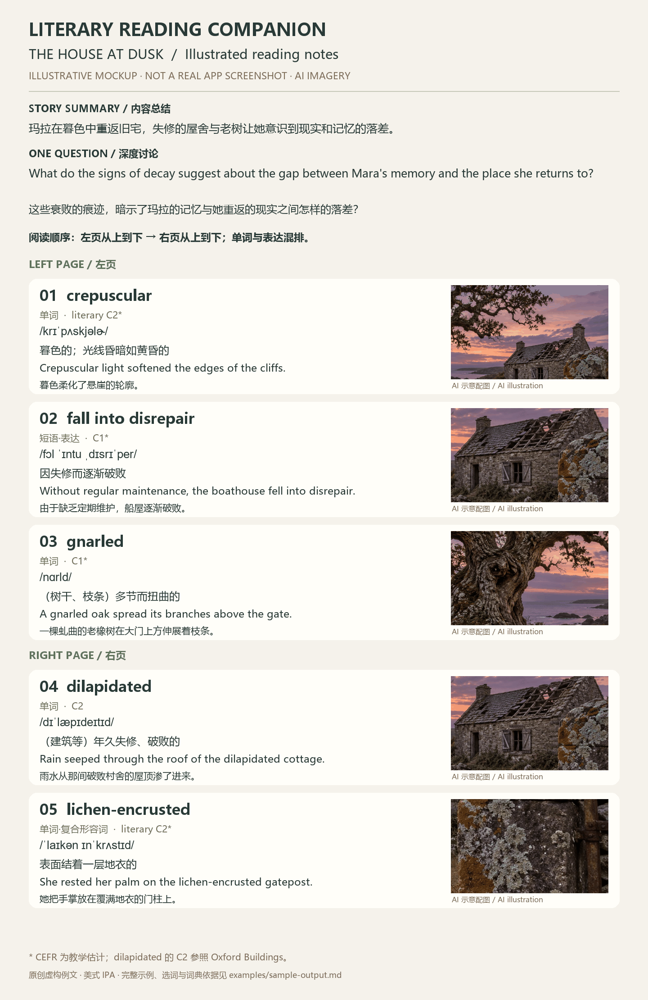
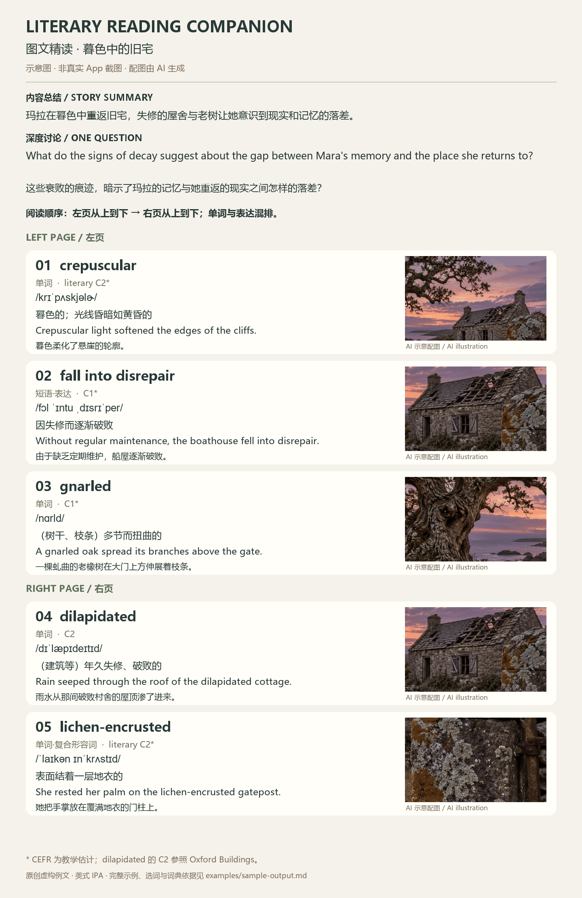

# Literary Reading Companion 📖

**An open-source, book-agnostic AI reading skill for B2–C1 English learners.**  
**Upload photos of English book pages → understand the passage → discuss one meaningful question → study challenging vocabulary in its original reading order, with pronunciation, Chinese explanations, examples, and visual references.**

**Not limited to *Circe*.** Use it with novels, classics, short stories, memoirs, essays, narrative nonfiction, and other English books. *Circe* by Madeline Miller is **only one example** of how this workflow can be used.

> Preview is an **illustrative mockup of the response structure**, not a screenshot of an actual ChatGPT session or a transcription of a copyrighted book.

## English

### What does this skill do?

| Step | Output |
| --- | --- |
| 1 · Read | Interpret a photograph of one or two facing pages; identify only readable text. |
| 2 · Summarize | A concise **Chinese story summary**, including relevant subtext, with no spoilers beyond the supplied pages. |
| 3 · Discuss | **One thoughtful question** in English, with Chinese translation; a real literary conversation, not a rote quiz. |
| 4 · Learn | Thorough **B2–C1 vocabulary plus useful literary C2 items** in exact page order: left page top-to-bottom, then right page top-to-bottom. |
| 5 · Visualize | Relevant images **immediately beside or below their entries**, before the next item; actively retrieve and display references when supported. |
| 6 · Continue | Maintain reading continuity across new page photos, and avoid needless repetition. |

Each vocabulary entry includes **American IPA**, approximate **CEFR level**, **contextual Chinese meaning**, a **newly written English example**, and its **Chinese translation**. Include meaningful phrases and uncommon literary words, but do not fill the list with trivial beginner vocabulary. Words and phrases are **interleaved in one numbered sequence**, never grouped by type or sorted by difficulty. Relevant B2 vocabulary should still be covered; the more demanding showcase below is not a minimum difficulty requirement.

### Supported books and genres

The workflow is **book-agnostic**: contemporary fiction, fantasy, historical fiction, mythology retellings, literary classics, crime fiction, science fiction, memoir, biographies, essays, and narrative nonfiction. Difficulty labels are approximate and should reflect usage and context, not claim official CEFR certification.

### Example output (original, fictional demonstration)

**V2.1 reading-order workflow:** select relevant B2–C2 words and expressions, then present them strictly in their original positions: left page top-to-bottom → right page top-to-bottom. Never sort the final output by frequency, difficulty, or word/phrase type.

This deliberately advanced showcase uses an **original two-page scene about returning to an abandoned coastal cottage at dusk**. Its source fragments and full response appear in [the complete illustrated sample](examples/sample-output.md). No published novel or real page numbers are implied.

**内容总结：** 玛拉在暮色中重返旧宅，失修的屋舍与老树让她意识到现实和记忆的落差。

**Discussion:** What do the signs of decay suggest about the gap between Mara's memory and the place she returns to?  
这些衰败的痕迹，暗示了玛拉的记忆与她重返的现实之间怎样的落差？

**Illustrated reading notes — LEFT PAGE**

**01 · crepuscular** — 单词 · /krɪˈpʌskjəlɚ/ · **literary C2**\*  
暮色的；光线昏暗如黄昏的。  
*Crepuscular light softened the edges of the cliffs.*  
暮色柔化了悬崖的轮廓。

**02 · fall into disrepair** — 短语·表达 · /fɔl ˈɪntu ˌdɪsrɪˈper/ · **C1**\*  
因失修而逐渐破败。  
*Without regular maintenance, the boathouse fell into disrepair.*  
由于缺乏定期维护，船屋逐渐破败。

**03 · gnarled** — 单词 · /nɑrld/ · **C1**\*  
（树干、枝条）多节而扭曲的。  
*A gnarled oak spread its branches above the gate.*  
一棵虬曲的老橡树在大门上方伸展着枝条。

**RIGHT PAGE — numbering continues**

**04 · dilapidated** — 单词 · /dɪˈlæpɪdeɪtɪd/ · **C2**  
（建筑等）年久失修、破败的。  
*Rain seeped through the roof of the dilapidated cottage.*  
雨水从那间破败村舍的屋顶渗了进来。

**05 · lichen-encrusted** — 单词·复合形容词 · /ˈlaɪkən ɪnˈkrʌstɪd/ · **literary C2**\*  
表面结着一层地衣的。  
*She rested her palm on the lichen-encrusted gatepost.*  
她把手掌放在覆满地衣的门柱上。

*All images above are AI-generated illustrative references / AI 生成示意配图，非实地摄影。The two preview PNGs are illustrative layouts, not real app screenshots.*

**Selection and accuracy:** the complete sample includes a reproducible wordfreq 3.1.1 screening table (candidate Zipf scores and selection reasons). First screen for lower commonness / greater lexical difficulty first, then choose scene-relevant, visually useful words. Restore source order before presenting. This demo emphasizes C1–C2; actual output still includes relevant B2 items. **\* = approximate editorial CEFR estimate, not a dictionary-certified label.** Oxford lists *dilapidated* under Buildings C2; the other showcased labels, including the compound *lichen-encrusted*, are teaching estimates. The full sample documents screening and [dictionary checks](examples/sample-output.md). Lower frequency is not itself proof of a CEFR level.

### Installation and usage

**Option A · ChatGPT / other assistants that support custom skills:**
1. Download this repository (green **Code → Download ZIP**) or clone it.
2. Locate [`SKILL.md`](SKILL.md). Import the skill folder using the skill installation method supported by your assistant. **Installing a GitHub repository does not automatically activate a skill in ChatGPT.** Availability and invocation syntax vary by product.
3. Upload a clear photograph of a book page and ask the assistant to use *Literary Reading Companion*. If your environment supports explicit skill invocation, use its own invocation method.

**Option B · Without skill installation:** Open [`SKILL.md`](SKILL.md), copy its instructions into your assistant's custom instructions or the current conversation, and upload book-page photos. This works as a reusable prompt, though image lookup and continuity depend on the platform.

**Example prompts:**
- “Analyze these two pages using Literary Reading Companion.”
- “Continue with the next pages. Keep vocabulary in the book's reading order.”
- “Explain *reprieve* with American IPA, Chinese meaning, and an example.”
- “Only discuss the character's choice this time; skip vocabulary.”

### Photo tips and limitations

- Keep both pages sharp, well-lit, and as flat as possible; avoid covering words with fingers.
- For difficult words or blurred text, upload a close-up rather than asking the assistant to guess.
- Visual support is a core part of the workflow: actively assess each entry and display a relevant image when tools support it. If retrieval or inline display is unavailable, explain once and place a specific “配图检索” suggestion immediately after each visualizable entry. Never claim an image was displayed when it was not.
- This is an **instruction-based skill**, not a standalone app or a guaranteed one-click ChatGPT integration. Results depend on the model and its enabled capabilities.
- Examples are original and do not reproduce copyrighted book passages.

### Files

- [`SKILL.md`](SKILL.md) — skill behavior and formatting instructions
- [`examples/sample-output.md`](examples/sample-output.md) — sample reading response
- [`assets/preview-english.png`](assets/preview-english.png) — illustrative response preview
- [`assets/preview-chinese.png`](assets/preview-chinese.png) — bilingual illustrative preview
- [`LICENSE`](LICENSE) — license

---

## 中文说明

**Literary Reading Companion（英文文学精读助手）** 是一个开源、可复用的 AI 阅读 Skill，面向 **B2→C1 英语学习者**。它**不绑定任何一本书**：小说、文学经典、散文、回忆录、传记、叙事类非虚构作品等，都可以使用。之前阅读的《Circe》（《喀耳刻》）只是演示案例之一。

> 图片是**排版示意图，非真实 App 或聊天截图**；配图为 AI 生成的写实风格示意，非实地摄影，也不是某本书的逐字摘录。新示例以暮色、虬曲老树、失修旧宅和地衣为线索，展示较难的文学词汇与表达。带 * 的 CEFR 为教学估计；完整例文附用法、音标及等级依据。

### 你会得到什么？

1. **剧情概括**：先用中文概括照片中的情节、人物关系和潜台词，不剧透后续章节。
2. **一个深度讨论问题**：英文问题配中文翻译；你回答后，可以继续自然讨论人物、选择、情感或主题。
3. **完整的 B2–C1 生词整理，并覆盖有价值的文学 C2 词语**：按**左页从上到下，再右页从上到下**的原文顺序，单词与短语混合为一条连续编号序列，不按字母、难度或类别重排。重点覆盖真正影响阅读的中高级词汇、文学表达和固定搭配，不遗漏 *flare / scoff / reprieve* 等常见但有难度的词。
4. **每个词都提供**：美式音标、约略 CEFR 等级、结合上下文的中文释义、原创英文例句和中文翻译。
5. **图片辅助记忆**：植物、动物、器物、动作等适合视觉记忆的词汇，在平台支持时于词条附近插入参考图片；不打乱单词顺序。
6. **连续阅读**：后续上传新页面时继续当前进度，尽量避免无意义的重复解释。

### 安装与使用

**方式 A：支持自定义 Skill 的 AI 平台**  
点击 GitHub 绿色 **Code → Download ZIP** 下载，解压后找到 [`SKILL.md`](SKILL.md)，按照所使用平台的 Skill 导入方式添加。**仅仅下载或收藏 GitHub 仓库，并不会自动安装到 ChatGPT。** 不同平台的调用方式可能不同。

**方式 B：直接当作提示词使用**  
打开 [`SKILL.md`](SKILL.md)，将指令复制到 AI 的自定义指令或聊天中，然后上传英文书页照片。图片显示、连续记忆等能力取决于所用平台。

**使用示例：**
- “请按照 Literary Reading Companion 的格式分析这两页。”
- “继续下一页，所有生词按原文出现顺序排列。”
- “解释 *flesh* 和 *flash* 的区别，给出美式音标和例句。”
- “这次先不整理单词，我们只讨论人物为什么做出这个决定。”

### 拍照建议

尽量保证文字清晰、光线均匀、书页平整，不要用手遮挡重要段落。遇到模糊词汇可单独补拍。Skill 不应凭空猜测看不清的内容，也不会自动提供平台不支持的联网图片能力。

### 开源说明

这是一个**阅读工作流 / 指令型 Skill**，不是需要付费 API 才能运行的独立应用。使用效果取决于你所选的 AI 模型、是否支持图片理解及图片检索，以及 Skill 安装机制。
