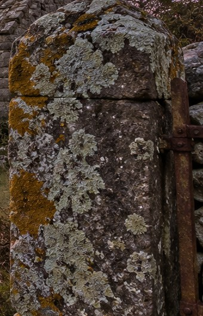

# Sample output — The house at dusk

> Original fictional demonstration / 原创虚构示例。Not a book quotation, uploaded page transcription, or real app screenshot. All photographs below are **AI-generated illustrative references**, not documentary photographs.

## Reading context / 阅读位置

No published book, chapter, or real page numbers are claimed. The following two short original page fragments make the demonstration order auditable; actual responses must use only the user's readable photographed text.

**LEFT PAGE — original demonstration text:**

In the crepuscular light, Mara saw that the estate had begun to fall into disrepair. A gnarled oak leaned over the gate.

**RIGHT PAGE — original demonstration text:**

Beyond it stood a dilapidated cottage. She touched a lichen-encrusted gatepost, trying to recall the garden as it had been.

## Story summary / 内容总结

玛拉在暮色中重返旧宅。失修的屋舍、虬曲的老树与覆满地衣的门柱，让她意识到眼前的家园已不同于记忆中的模样。

## Discussion / 深度讨论

**What do the signs of decay suggest about the gap between Mara's memory and the place she returns to?**

这些衰败的痕迹，暗示了玛拉的记忆与她重返的现实之间怎样的落差？

## Illustrated reading notes / 按原文顺序的图文精读

Words and expressions share one sequence: left page top-to-bottom, then right page top-to-bottom. Difficulty is a selection filter, never a sorting rule.

### LEFT PAGE

**01 · crepuscular** — 单词  
**American IPA:** /krɪˈpʌskjəlɚ/  
**CEFR:** literary C2*  
**语境含义：** 暮色的；光线昏暗如黄昏的。  
**Example:** Crepuscular light softened the edges of the cliffs.  
**例句翻译：** 暮色柔化了悬崖的轮廓。

*AI-generated illustrative reference / AI 生成示意配图。*

**02 · fall into disrepair** — 短语·表达  
**American IPA:** /fɔl ˈɪntu ˌdɪsrɪˈper/  
**CEFR:** C1*  
**语境含义：** 因失修而逐渐破败。  
**Example:** Without regular maintenance, the boathouse fell into disrepair.  
**例句翻译：** 由于缺乏定期维护，船屋逐渐破败。

*AI-generated illustrative reference / AI 生成示意配图。*

**03 · gnarled** — 单词  
**American IPA:** /nɑrld/  
**CEFR:** C1*  
**语境含义：** （树干、枝条）多节而扭曲的。  
**Example:** A gnarled oak spread its branches above the gate.  
**例句翻译：** 一棵虬曲的老橡树在大门上方伸展着枝条。

*AI-generated illustrative reference / AI 生成示意配图。*

### RIGHT PAGE

**04 · dilapidated** — 单词  
**American IPA:** /dɪˈlæpɪdeɪtɪd/  
**CEFR:** C2  
**语境含义：** （建筑等）年久失修、破败的。  
**Example:** Rain seeped through the roof of the dilapidated cottage.  
**例句翻译：** 雨水从那间破败村舍的屋顶渗了进来。

*AI-generated illustrative reference / AI 生成示意配图。*

**05 · lichen-encrusted** — 单词·复合形容词  
**American IPA:** /ˈlaɪkən ɪnˈkrʌstɪd/  
**CEFR:** literary C2*  
**语境含义：** 表面结着一层地衣的。  
**Example:** She rested her palm on the lichen-encrusted gatepost.  
**例句翻译：** 她把手掌放在覆满地衣的门柱上。

用法：由名词 *lichen* 与过去分词 *encrusted* 构成的复合形容词；置于名词前加连字符。地衣不等同于苔藓。

*AI-generated illustrative reference / AI 生成示意配图。*

## Selection, levels, and usage checks / 选词与核对

The intended learner remains B2–C1; this deliberately demanding showcase selects C1–C2 literary items. Actual reading notes must still cover relevant B2 vocabulary and must never substitute showcase words for words on a photographed page.

First screen candidates for lower general-English frequency or greater lexical difficulty; then choose useful, scene-specific visual items. Finally restore the source reading order. Low frequency alone does not establish CEFR level. Frequency screening is relative to general English, not a claim about frequency in all novels.

### Reproducible frequency screen

Screened with **wordfreq 3.1.1**, `zipf_frequency(term, 'en')`, on 2026-10-29. Lower Zipf scores mean less common general-English usage; a one-point difference corresponds to roughly tenfold frequency. Use **Zipf < 3.3 OR a justified advanced literary sense** as a candidate filter here, then assess usefulness and visual relevance. This small, scene-directed candidate pool is not a corpus-wide ranking. Multiword/hyphenated scores are model estimates from component words, not measured collocation frequencies, so they are not used as independent selection evidence.

| Candidate / baseline | Zipf | Decision for this scene |
| --- | ---: | --- |
| crepuscular | 1.87 | Keep: precise literary twilight sense. |
| gnarled | 2.37 | Keep: visible tree texture and shape. |
| dilapidated | 3.05 | Keep: advanced building description; Oxford Buildings C2. |
| disrepair | 2.79 | Keep within the attested phrase *fall into disrepair*. |
| lichen / encrusted | 2.77 / 2.75 | Keep as a transparent compound; visual surface detail. |
| ramshackle | 2.43 | Omit: overlaps with the selected building description. |
| tenebrous | 1.44 | Omit: unnecessarily obscure and less precise for this scene. |
| weathered | 3.15 | Omit: less specific than the selected surface details. |
| glimpse (old showcase baseline) | 3.81 | Retire from the main showcase. |
| relent (old showcase baseline) | 2.52 | Retire: less visually specific here, despite its low frequency. |

These results do **not** show that every selected item is rarer than *relent*. They support screening for lower commonness, followed by lexical difficulty, context, and visual usefulness. The response order above follows the original demonstration fragments, not this candidate table.

**An asterisk means an editorial teaching estimate**, not an official CEFR assignment. Cambridge labels *crepuscular* literary but supplies no CEFR label in the checked entry. The checked *gnarled*, *disrepair*, and *lichen* entries likewise do not establish the CEFR labels used here. *Lichen-encrusted* has no independently verified compound-level CEFR label; its C2 estimate reflects the specialist noun and compound description. Oxford places *dilapidated* in its Buildings C2 topic. American IPA is given in broad transcription; phrase stress can vary in connected speech.

Usage and pronunciation references (checked 2026-10-29; definitions and examples here are independently written):

- [Cambridge: crepuscular](https://dictionary.cambridge.org/dictionary/english/crepuscular) — twilight sense, distinct from the biological activity sense.
- [Cambridge: disrepair](https://dictionary.cambridge.org/us/dictionary/english/disrepair) — attests the collocation *fall into disrepair*.
- [Cambridge: gnarled](https://dictionary.cambridge.org/us/dictionary/english/gnarled) — rough, twisted tree or body-part sense; initial g is silent.
- [Oxford: dilapidated](https://www.oxfordlearnersdictionaries.com/us/definition/english/dilapidated) — building/furniture sense, pronunciation, Buildings C2 topic.
- [Cambridge: lichen](https://dictionary.cambridge.org/us/dictionary/english/lichen) — organism growing on rock, walls, and trees; /ˈlaɪkən/ is one accepted US pronunciation.
- [Collins: encrusted](https://www.collinsdictionary.com/dictionary/english/encrusted) — surface coating sense; the compound is an original transparent combination, not a quoted dictionary headword.

The preview PNGs are typeset editorial demonstrations of this same sequence. They are not screenshots of ChatGPT or an installed app. Image crops are reused where the same cottage illustrates both a state (*dilapidated*) and its development (*fall into disrepair*).
